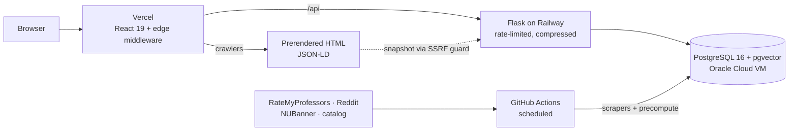
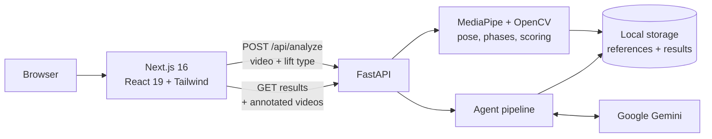
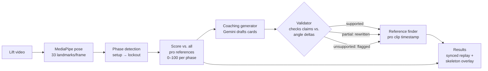

# Hey, I'm Cory Pierson

 
Cybersecurity @ Northeastern University (2029) | New York -> Massachusetts
 

---

## Public Projects

###  RateMyHusky

[GitHub](https://github.com/RateMyHusky/RateMyHusky) · [ratemyhusky.com](https://ratemyhusky.com)

**Oasis @ Northeastern · Team project**

A professor and course discovery site for Northeastern students, with pages for about 9,300 professors. Each professor gets one profile that combines RateMyProfessors ratings, Reddit discussion, Northeastern's course schedule (every term since Fall 2021), the course catalog, and teaching awards. Search, filtering, and side-by-side comparison sit on top. React 19 + TypeScript on Vercel, Flask on Railway, PostgreSQL 16 + pgvector on an Oracle Cloud VM. AGPL-3.0.

<b>Architecture</b>

<b>What I built</b>

- *Proxy & session security*: Resolved the real client IP behind the proxy, compared the proxy key in constant time, fixed login CSRF, and shortened session tokens
- *Browser & input hardening*: Added a report-only Content-Security-Policy with a violation-report endpoint, validated paging and search input, and rendered only http(s) links from scraped data
- *Abuse prevention & privacy*: Put CAPTCHA and per-IP limits on the feedback and rating forms, and set a 30-day retention limit on AI query logs
- *Accounts & auth*: Built bookmarks end to end: a backend module, Flask routes, a React context with optimistic updates, and a bookmarks page. Fixed Google sign-in so it only redirects to paths on the site, stays in sync across open tabs, and completes when started in two tabs
- *Compare*: Reworked the side-by-side compare table, adding per-metric best and second-best picks, tie handling, rating-count bars, and clear marking for professors with too few ratings to rank

<b>The platform</b>

- *Data pipeline*: Custom Python scrapers for RateMyProfessors, Reddit, the NUBanner course schedule, and the course catalog. They load 43K+ ratings and about 9K Reddit mentions into one PostgreSQL schema, which `precompute` jobs rebuild on a schedule via GitHub Actions
- *Entity resolution*: A layered matcher (calibration, surname stoplists, thread anchoring) keeps false matches out of the Reddit mentions it links to professors, and each mention gets a sentiment score. Automatic face focal-point detection crops about 2,000 professor photos correctly
- *Product*: Professor, course, and department pages, autocomplete search, side-by-side compare, a top-rated leaderboard, rating-history, radar and grade-distribution charts, dark mode, and a moderated student rating form
- *AI search (paused)*: Hybrid retrieval that fuses full-text search with BGE-small embeddings using Reciprocal Rank Fusion, with prompt-injection guards, plus an offline evaluation harness (nDCG@k, recall@k, MRR) built on human-labeled relevance judgments
- *SEO*: Flask-rendered snapshots for crawlers with JSON-LD, edge middleware, behind an SSRF guard, that routes bots to prerendered HTML, a sitemap generated at build time, `llms.txt`, and Bing IndexNow
- *Delivery*: A rate-limited, compressed API and GitHub Actions CI (build, lint, pytest, and a gitleaks secret scan of the full history)

---

### <picture><source media="(prefers-color-scheme: dark)" srcset="assets/momentum-light.png"></picture>

[GitHub](https://github.com/Cory585/babson26)

**Babson 2026 Hackathon (Semifinalist)**

AI-powered weightlifting form analysis built in 8 hours. Upload a lift video and get biomechanically validated coaching feedback compared against professional references.

<b>Architecture</b>

**System**

**Analysis pipeline**

<b>How it works</b>

- *MediaPipe*: Extracts pose keypoints frame by frame and detects lift phases (setup → descent → bottom → lockout)
- *Scoring*: Weighted joint angles (knee, hip, back, ankle) produce a 0–100 similarity score across phases
- *Three-agent pipeline*: Gemini generates coaching cards, a hallucination validator fact-checks every claim against raw angle data, and a reference finder links each issue to the exact timestamp in the pro footage
- *UI*: Side-by-side synced video player with skeleton overlay and per-phase score breakdown

---

###  Password Manager

[GitHub](https://github.com/Cory585/Password-Manager-Project)

A command-line password manager that keeps credentials in a local, encrypted SQLite vault, unlocked by a single master password.

<b>Details</b>

- *Master password*: Hashed with Argon2id; the plaintext is never written to disk
- *Per-entry keys*: Each entry has its own random 16-byte salt, and PBKDF2-HMAC-SHA256 (480,000 iterations) derives a separate 32-byte key for it, so no two entries share a key
- *Encryption*: AES-256-GCM with a fresh 12-byte nonce on every write. The authentication tag catches tampering on decrypt
- *CLI*: `init`, `add`, `get`, `list`, `delete`, and a secure random password generator

